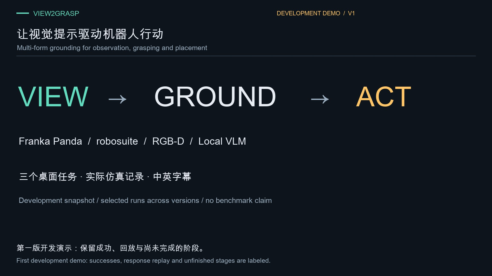

# View2Grasp

[](artifacts/demo-v1/view2grasp_explained_1080p.mp4)

**[▶ Watch the system demo — 4:51 · 1080p · Chinese / English captions](artifacts/demo-v1/view2grasp_explained_1080p.mp4)**

System principles and three tabletop tasks, with online runs, response replay, and earlier-build results labeled. [Video details and sources](docs/demo-v1.md).

Language-conditioned visual grounding for active-view grasping, navigation, and mobile manipulation. MIT-licensed project code; third-party simulators, assets, and model weights retain their own licenses.

Taking over development? Start with the [project handoff and completion roadmap (Chinese)](docs/HANDOFF.zh-CN.md): current evidence, setup, remaining blockers, milestones, and acceptance criteria.

## Status

This is a research prototype. Current tabletop evidence: block online success; occluded pick/place success with recorded VLM responses; mug grounding and closure completed, but the updated lift was blocked by unknown space. Three earlier online tabletop successes are preserved; that earlier implementation used inferred free-space completion and is **not evidence for the updated safety checks**. The large benchmark has been cancelled in favor of approximately 10–15 targeted development runs. See [results](docs/results.md) and the [first demo and source records](docs/demo-v1.md).

Implemented and measured: multiform proposal schemas and overlays; actual local VLM probes for points/boxes/polygons/paths; CPU SAM 2.1 segmentation; isolated RoboCasa installation and kitchen rendering; robot-only FK/control/self-depth checks; online navigation and coffee grounding trials. A navigation development run moved 26.76 cm without collision; a coffee run used calibration-only camera advice and safely retreated 32.84 cm. Both later aborted and are not task successes. All failures are retained. Engineering tests are offline checks, not online robot episodes.

The extension accepts points, boxes, polygons/masks, and image-space paths. Semantic predictions propose actions; calibrated depth and collision-checked planning decide whether they are executable. Simulator object poses, instance masks, and success signals must not enter the agent boundary.

## Tabletop installation

```sh
uv sync --locked
export VLM_BASE_URL=http://127.0.0.1:8318/v1
export VLM_API_KEY=local
export VLM_MODEL=gt-6-as-a
uv run view2grasp doctor
uv run pytest -q
uv run view2grasp run --task block --seed 3 --root runs/development
```

Optional verified SAM backend (otherwise `auto` logs RGB-D fallback):

```sh
SAM2_BUILD_CUDA=0 uv sync --locked --extra perception
uv run --extra perception python scripts/download_sam.py
uv run --extra perception view2grasp run --task block --seed 3 --root runs/development-sam
```

SAM code and weight hashes are pinned in `uv.lock` and `configs/model_weights.json`. Image trajectories are intent: ground paths guide SE(2) search; unconstrained end-effector paths weakly rank existing grasp candidates without sampling background depth or changing the 15° cone. See [architecture](docs/architecture.md) and [third-party notices](THIRD_PARTY_NOTICES.md).

Python 3.11, robosuite 1.5.2, and MuJoCo 3.3.7 are pinned for the tabletop runtime. macOS interactive viewers require `mjpython`; recordings use offscreen rendering.

## Tasks and protocol

Tabletop: `block`, `mug`, `occluded`. The procedural mug deliberately has an oversized through-handle compatible with the complete Panda hand; it does not represent an ordinary household mug.

RoboCasa extension: `NavigateKitchen` and the simpler `DeliverCanToBowl`, with robot-mounted cameras and PandaOmron. `DeliverBrewedCoffee` is deferred as a stretch task. The runtime is isolated under `runtimes/robocasa`; do not upgrade the tabletop environment to satisfy RoboCasa dependencies. Installation and current limitations are in [RoboCasa setup](docs/robocasa.md).

Fixed, random, and active observation policies share perception and planning, but no exhaustive sweep is requested. Small validation defaults to five tasks × development seeds 3/4/5 × active policy = 15 episodes maximum. Diagnose existing recordings offline before retrying online. Response replay is excluded from online counts; these development trials do not establish statistical superiority. The old 100–119 seed field is retained only for configuration compatibility and is not used by `evaluate`.

```sh
uv run view2grasp evaluate --dry-run
uv run view2grasp summarize --root runs/validation
uv run view2grasp replay runs/development/block_active_0003
```

The dry run prints 15 proposed episode IDs without creating experiments. The CLI rejects validation batches above 15; it does not automatically launch a 300-trial benchmark. `validation_seeds` can reduce the batch further. No new batch should be launched merely because a previous attempt failed at the same unchanged blocker. Kitchen layout 2 is a developmental scene, not a held-out benchmark.

The CLI's available backend support is reported by `--help`; a declared task is not a claim of successful execution. Raw observations, calibration, model requests/responses, candidate geometry, trajectories, and isolated evaluation truth are retained. The [first captioned development demo](artifacts/demo-v1/view2grasp_explained_1080p.mp4) explains the system and shows selected tabletop runs. Historical success, response replay, and current partial execution are explicitly labeled. This is not a final five-task evaluation video.

Historical records may contain an incorrect robot-only `scene.xml` because MuJoCo XML export depends on the last compiled model. New adapters snapshot the scene before compiling the planning model. Original historical execution videos remain valid visual records, but those older XML files must not be called fully state-replayable. Replay now validates scene/state compatibility.
